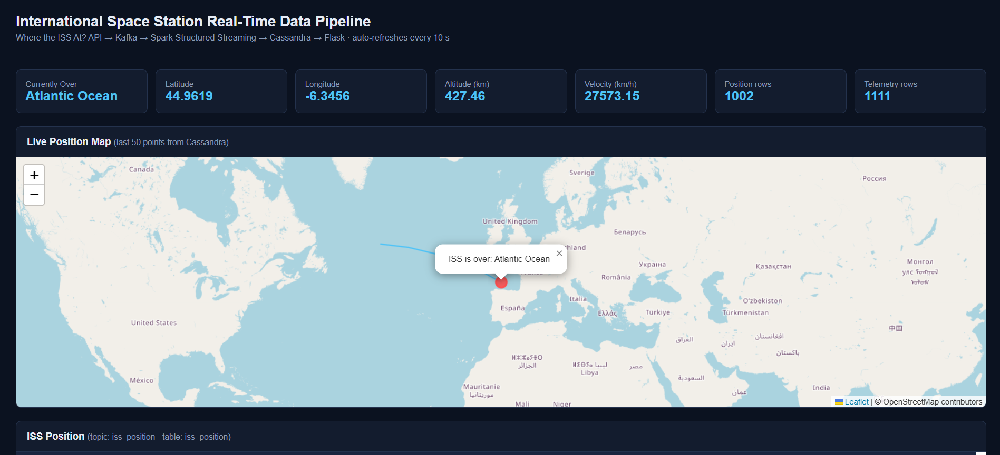
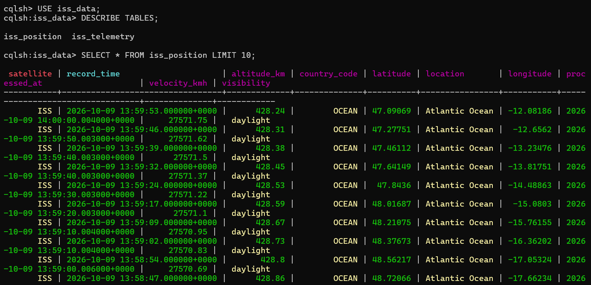
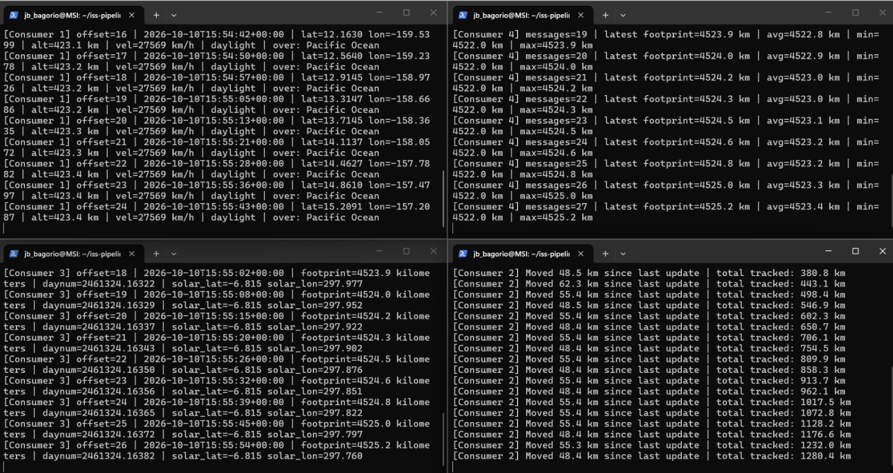
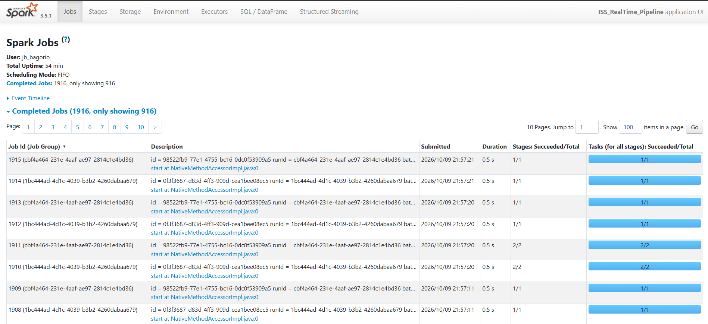

# Real-Time ISS Tracking Data Pipeline

A streaming data pipeline that tracks the International Space Station in real time.
Live data flows from a public API through Kafka and Spark into Cassandra, and is displayed on a Flask dashboard with a live map.

## Architecture
Where the ISS At? API
├── Producer 1 (position) ──► Kafka topic: iss_position ──┐
└── Producer 2 (telemetry) ──► Kafka topic: iss_telemetry ──┤
├──► 4 Consumers (2 per topic, independent groups)
▼
Spark Structured Streaming
▼
Cassandra (iss_data.iss_position / iss_telemetry)
▼
Flask dashboard + Leaflet map

## Tech Stack
Python · Apache Kafka · Apache Spark (Structured Streaming) · Apache Cassandra · Flask · Docker Compose · Leaflet

## Features
- Two producers polling the API every 5 seconds and publishing JSON to separate Kafka topics
- Four independent consumers: position logger, location tracker, telemetry logger, telemetry stats
- Spark job that parses, cleans and writes both streams to Cassandra in 10-second micro-batches
- Country/ocean detection for the ISS's current position
- Flask dashboard with live stats, a map of the ISS's path, and scrollable data tables

## Setup
Requirements: Docker Desktop, Python 3.11, Java 17

```bash
python3.11 -m venv venv && source venv/bin/activate
pip install -r requirements.txt
docker compose up -d
```

Create the Kafka topics:
```bash
docker exec -it kafka /opt/kafka/bin/kafka-topics.sh --create --topic iss_position --bootstrap-server localhost:9092 --partitions 1 --replication-factor 1
docker exec -it kafka /opt/kafka/bin/kafka-topics.sh --create --topic iss_telemetry --bootstrap-server localhost:9092 --partitions 1 --replication-factor 1
```

Create the Cassandra schema:
```bash
docker cp cassandra/schema.cql cassandra:/schema.cql
docker exec -it cassandra cqlsh -f /schema.cql
```

## Running
Run each in a separate terminal:
```bash
python producers/producer_position.py
python producers/producer_telemetry.py
python spark/spark_stream.py
python flask_app/app.py
python consumers/consumer1_position_logger.py   # optional, also consumer2–4
```
Open http://localhost:5000 for the dashboard and http://localhost:4040 for the Spark UI.

## Screenshots




